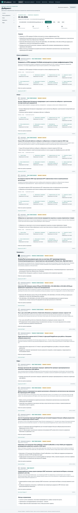

# SOC Digest · Team Truffle case study

[Русская версия](README.md)

An AI assistant that collects IT and cybersecurity publications, selects them for a reader's interests, and produces a topical digest with verbatim quotations and links to the original sources.

The prototype was built for the October 2026 semifinal of the “AI Assistants for Energy” hackathon, for the “IT/Cybersecurity Digest Assistant” challenge.

> This repository contains the case study, architecture, research notes, and sample output. It does not contain the collector, parser, or pipeline source code.

## What it does

- **Two issues for two audiences:**
  - a daily issue for technical specialists, covering 08:00–08:00 Moscow time;
  - a management summary for the previous calendar month.
- **Interest-based selection:**
  - audience profiles with topic weights, exclusions, and watched product classes;
  - an inventory of “our” products and versions to assess applicability;
  - P1–P3 priorities with the reason for each decision retained.
- **Grouping:**
  - publications about one event are merged while all sources remain available;
  - issues are divided into sections such as “Attack,” “Vulnerability,” and “Information,” and start with “Highlights.”
- **Traceability:** every claim in a card has a verbatim quotation from a source publication. If the quotation is absent from the source text, it is rejected. A claim without a verified quotation is omitted from the issue.
- **Formats:** web page, Markdown, HTML, JSON (the [`issue_v1` schema](schemas/issue_v1.json)), and DOCX.

## Results on the working corpus

Snapshot from October 3–4, 2026. These figures describe volume and system behavior, not accuracy against expert labels.

| Metric | Result |
|---|---|
| Publications in the corpus | 896 from 77 sources (websites, Telegram channels, CISA KEV) |
| Initial LLM labeling | 577 publications; about 7 hours of sequential processing |
| Daily technical issue | 564 publications → 563 events → 459 eligible → **14 cards** |
| Monthly management summary | 33 eligible events → **8 cards** |
| Where time is spent | 99.97% waiting for the LLM; collection, validation, and storage < 0.1% |
| Cost per new publication | ~40–46 seconds of LLM time (classification and extraction) |

Details are in the [research notes](docs/research.en.md).

## Documentation

- [Architecture](docs/architecture.en.md): pipeline, storage, and deployment.
- [Method](docs/method.en.md): how items are selected and verified.
- [Research](docs/research.en.md): timing, rules versus classifier versus LLM, and transfer across sources.
- [Data schemas](schemas/): `classify_v1`, `extract_v1`, and `issue_v1`.
- [Synthetic daily issue](examples/demo/tech-daily.en.md) and [synthetic monthly issue](examples/demo/management-monthly.en.md), both editorial English translations of fictional examples. The [screenshots](screenshots/) show real Russian-language issues.

## Stack

Python 3.12, pydantic, httpx, SQLite, FastAPI, a static HTML/CSS/JS frontend, and scikit-learn. The LLM connects through an OpenAI-compatible API or Ollama's native protocol. Configuration maps an alias to a model, so the model can be replaced without changing the code. The research runs used Claude Haiku 4.5 and GLM-5.3-flash.

## Limitations

- Quality against expert labels was not measured: the local classifier was trained on weak labels supplied by an LLM.
- The corpus is skewed: 496 of the 577 labeled publications came from one source.
- Publications are processed sequentially, so the initial load of a large archive takes hours.
- Checking that a quotation appears in a source does not establish that the claim accurately interprets it.
- Time saved for human analysts was not measured.

## Team and license

Team Truffle («Трюфель»); Maksim is responsible for the prototype's codebase. Original text, schemas, synthetic examples, and screenshot presentation are licensed under [CC BY 4.0](LICENSE). Third-party quotations and material visible in screenshots are excluded from that license.
