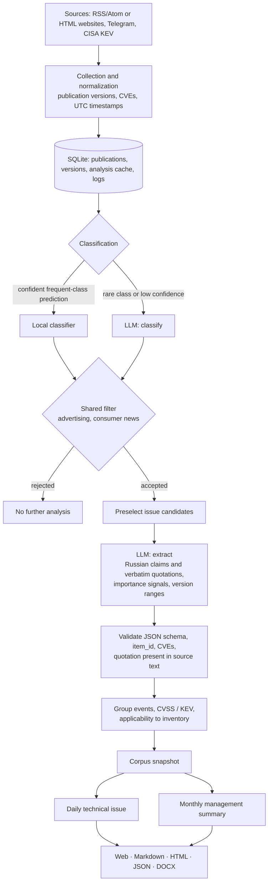
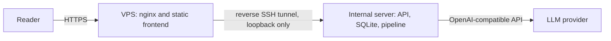

# Architecture

[Русская версия](architecture.md)

## Pipeline

## Key decisions

- **Content-based cache.** An analysis result is tied to the publication text, model, prompt version, and schema version. Rerunning the same content does not make new model requests: 754 results came from the cache on the second pass over the working corpus.
- **Limited retry.** If a response fails schema or quotation validation, the model gets one retry with a simplified schema. Timeouts and network errors do not trigger retries, and there is no automatic switch to a paid model.
- **Partial rejection.** An unverified quotation is discarded, as is a claim left without quotations. A publication is rejected only if no verified claims remain.
- **Corpus snapshot.** An issue is assembled from an immutable event snapshot. A published issue is fixed to its period and cannot be silently replaced; a rerun is available only as a preview.
- **No look-ahead.** An issue for a period cannot be built from a snapshot taken before that period ends.
- **Model replacement.** A model alias specifies its endpoint, protocol, limits, and key environment variable. Output validation is the same for every model.

## Prototype deployment

- The public server serves static files and proxies the API. The database, processing, and model keys remain on the internal server.
- The internal server opens the tunnel. The tunnel account on the public server has no shell and can forward only one port.
- Administrative actions require an access code; reading issues is open.

The public server needs roughly 1 vCPU and 1 GB of RAM. The internal server needs about 1–2 GB of RAM for a pipeline using an external LLM; most of its time is spent waiting for model responses.
