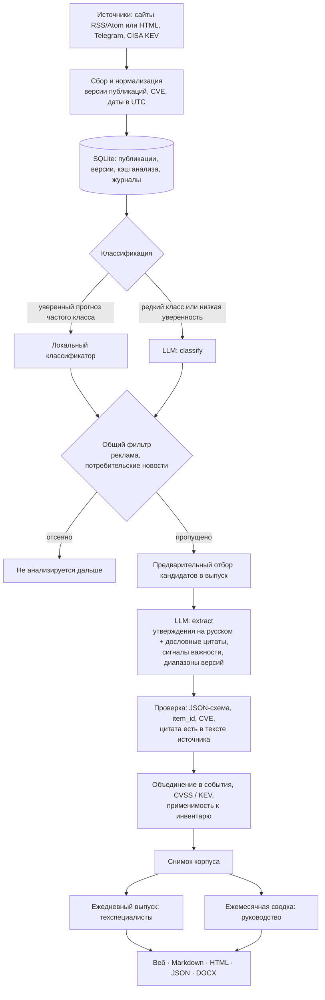
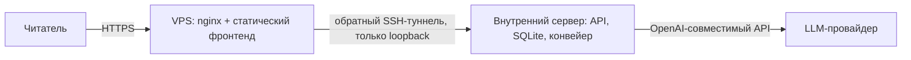

# Архитектура

## Конвейер

## Ключевые решения

- **Кэш по содержимому.** Результат анализа привязан к тексту публикации, модели, версии промпта и схемы. Повторный прогон не делает новых запросов: во втором проходе рабочего корпуса 754 результата взяты из кэша.
- **Ограниченный повтор.** Если ответ не прошёл схему или проверку цитат, модели отправляется один повторный запрос с упрощённой схемой. Тайм-аут и сетевая ошибка повтора не вызывают, автоматического переключения на платную модель нет.
- **Частичная отбраковка.** Неподтверждённая цитата выбрасывается, утверждение без цитат — тоже. Публикация отклоняется, только если не осталось ни одного подтверждённого утверждения.
- **Снимок корпуса.** Выпуск собирается из неизменяемого снимка событий. Опубликованный выпуск закреплён за своим периодом и не подменяется; повторная сборка возможна только как предпросмотр.
- **Без заглядывания в будущее.** Выпуск за период нельзя собрать из снимка, сделанного раньше конца периода.
- **Замена модели.** Модель задаётся алиасом: адрес, протокол, лимиты, переменная с ключом. Проверки на выходе одинаковы для любой модели.

## Развёртывание прототипа

- Публичный сервер раздаёт только статику и проксирует API. База, обработка и ключи моделей остаются на внутреннем сервере.
- Туннель открывает внутренний сервер; на публичном сервере у него нет оболочки, разрешено только перенаправление одного порта.
- Действия управления закрыты кодом доступа; чтение выпусков открыто.

Требования к ресурсам: публичному серверу хватает 1 vCPU и 1 ГБ RAM. Внутреннему для конвейера с внешней LLM — около 1–2 ГБ RAM; почти всё время он ждёт ответа модели.
